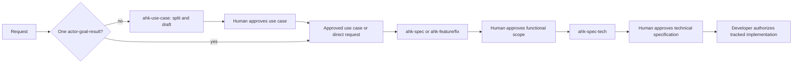
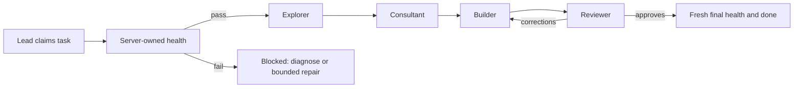

# @cardor/agent-harness-kit


[](https://snyk.io/test/npm/@cardor/agent-harness-kit)

Agent Harness Kit (AHK) gives AI coding providers a shared workflow for documents, tracked tasks, handoffs, and health evidence. It supports Claude Code, Codex CLI, Cursor, Grok Build, OpenCode, and OpenCode V2.

AHK supplies structure and records. Your provider supplies the model and its own permissions; prompt instructions, including Codex instructions, are not a security boundary.

```bash
pnpm add -g @cardor/agent-harness-kit
# or: npm install -g @cardor/agent-harness-kit
# or: bun add -g @cardor/agent-harness-kit
# Yarn Classic (v1) only: yarn global add @cardor/agent-harness-kit

ahk init
```

Yarn Modern (Berry) removed `yarn global`; install AHK globally through pnpm, npm, or Bun instead.

For the complete offline product guide after installation, ask: “Use `ahk-docs` to explain how AHK works.” The same bundled guide is in [the source skill](src/core/materializer/skills/ahk-docs/SKILL.md).

See [CHANGELOG.md](CHANGELOG.md) for versioned changes and migration requirements.

## Choose a workflow

Ask explicitly for a skill when predictable routing matters. Natural-language routing can help, but provider skill selection is not guaranteed.

| What you need | Ask for | Produces | Does not do |
| --- | --- | --- | --- |
| Clarify one actor, goal, and result | `ahk-use-case` | Draft in `docs/use-cases/` | Architecture or implementation |
| Define functional scope | `ahk-spec` | Functional spec in `docs/specs/` | Technical design |
| Design implementation after approval | `ahk-spec-tech` | Linked technical spec | Implementation |
| Turn a pasted request into a feature or fix spec | `ahk-feature` / `ahk-fix` | Functional specification | Fetch Jira automatically |
| Diagnose a bug | `ahk-triage` | Evidence-backed report | Code changes |
| Ask about project code | `ahk-ask` | Read-only answer | Task state |
| Compare approaches | `ahk-consultant` | Read-only advice | Implementation |
| Write behavior tests only | `ahk-test` | Tests and evidence | Production/config/dependency changes |
| Preview a review | `ahk-review` | Review rubric | Official approval |
| Learn AHK itself | `ahk-docs` | Read-only product guide | Any mutation |

Examples:

```text
Use ahk-use-case to define passwordless sign-in for an existing account.
Use ahk-feature to turn this pasted Jira card into an approved functional spec; do not implement it.
Use ahk-triage to explain why checkout retries twice. Do not change code.
Use ahk-docs to explain the health gate and repair mode.
```

The lightweight skills above are useful entry points, not mandatory stages. `ahk-consultant` is a read-only skill; the consultant role below is part of tracked development.

## From idea to verified work



Start `ahk-use-case` for an unclear initiative. It asks one decision at a time and separates independent actor-goal-result scenarios into linked use cases. Each coherent draft is saved before explicit human approval. A well-defined request may begin with `ahk-spec`, `ahk-feature`, or `ahk-fix`. Technical specification follows only an approved functional source. Approval of a document does not authorize implementation.



The lead coordinates the five roles. A reviewer may send bounded feedback back to the builder. MCP owns the task claim, action log, handoffs, and final health result; the document files remain on the filesystem.

## Quick start

Run the globally installed `ahk init` in the current directory. It asks for provider, docs path, and storage choices, and creates a native health-script starter when one is missing. Replace that starter with commands that actually verify your project. A health script that always succeeds is not valid completion evidence.

Open or restart your provider after initialization so it reloads its MCP configuration. Claude Code uses the project-root `.mcp.json`; AHK also materializes native files for Codex, Cursor, Grok Build, OpenCode, and OpenCode V2.

Then make a bounded first request:

```text
Use ahk-feature to define a functional spec from this request. Save a draft, ask for approval, and do not create a task or implement code.
```

### Installation and storage

A globally installed `ahk` command and global database storage are different settings:

- A global CLI is the executable on your `PATH`.
- Global storage keeps the harness database in the user's harness home storage.
- Local storage commonly keeps it in `.harness/harness.db`.

`ahk init` does not create a home-directory provider scaffold. Agent and skill files it creates stay in the current project. The detailed setup and provider guide ships with [`ahk-docs`](src/core/materializer/skills/ahk-docs/resources/setup-and-providers.md).

## OpenCode V2

Choose **OpenCode V2** in `ahk init`, or use `ahk migrate --to opencode-v2` for an existing project. The existing `opencode` provider remains v1. Both versions share the `opencode` executable and `.opencode` paths; choosing a provider neither installs a runtime nor isolates the two versions.

V2 generates native `mcp.servers` over stdio with direct tools (`codemode: false`), complete native agent frontmatter, lead as primary and four subagents, ordered permissions, and the existing skills/resources. `ahk models` accepts per-role `provider/model#variant` references or inheritance without a fixed model catalog. Nonimplementing roles deny edits and arbitrary shell commands; reviewer health/test exceptions can still create local build artifacts. These permissions are tool controls, not an OS sandbox.

JSONC edits preserve comments and unrelated settings. Invalid, duplicate or ambiguous config paths and customized v1 shared agents stop migration before replacement. Canonical v1 conversion is backed up; returning to v1 requires the documented recovery rather than feeding native v2 files to v1. Install the v2 sound adapter with `ahk notifications install --provider opencode-v2`. Owned v1 hooks are replaced during migration; edited or foreign hooks are preserved as conflicts.

See the bundled [OpenCode V2 guide](src/core/materializer/skills/ahk-docs/resources/opencode-v2.md) for locations, models, permissions, migration/recovery, diagnostics and evidence. Runtime integration was exercised against isolated OpenCode **2.1.4** with a deterministic local model provider; this does not establish paid-model quality or audible sound delivery.

## What AHK tracks

Specifications are Markdown artifacts: use cases live in `docs/use-cases/`; functional and technical specifications live in `docs/specs/`. Tasks, actions, acceptance evidence, and handoffs are harness data, normally backed by the configured database.

`specs.list` returns valid document metadata, `nextOffset`, and an always-present `diagnostics` array of `{ path, message }` for invalid or ambiguous files. Diagnostic paths are relative to the configured docs directory, for example `specs/broken.md`. Diagnostics cover both document roots even when filters or pagination hide items. Discovery reads only immediate `.md` files and excludes `README.md` indexes case-insensitively; other Markdown files, including `index.md`, must have valid specification frontmatter. Duplicate filenames across the roots are excluded with a diagnostic for each path. Reading, searching, validation, and mutations retain strict document validation.

On a tracked task, `tasks.claim` runs native health. A pass enables normal work. A failure enters blocked mode: diagnosis remains available, while implementation needs a bounded, audited `tasks.repair.begin(...)` authorization. `tasks.update(..., 'done')` runs fresh final health and closes only when it passes.

Operational notices — lifecycle MCP responses, `ahk build`, `ahk sync`, and `ahk doctor` surface cached upgrade and generated-skill migration information without changing task or health results. Suggested commands require developer approval.

Database latency notices measure actual driver calls after schema setup, including calls inside transactions, without timing health scripts or logging SQL/data. Observations are per connection and memory-only: short CLI sessions may not gather enough samples, and nothing persists across processes. Normal DB-backed MCP task/action/health tools can add one informational notice block; their primary text, structured output, errors and health gates stay unchanged. Filesystem tools receive no DB notices. CLI notices go to stderr even with `--json`; `serve` uses MCP notices only.

`ahk doctor --db` or MCP `ahk.doctor` with `{ "db": true }` opts into cached history diagnostics. Ordinary doctor remains metadata-only. The optional scan counts completed tasks whose `completed_at` is older than 90 days, including archived history; at least 1,000 is a history-review heuristic. SQLite main+WAL size is optional context; remote size may be unknown. These facts do not establish a cause of latency. No cleanup, deletion, VACUUM or checkpoint runs automatically; review retention and preserve needed history before planning manual maintenance. A missing SQLite file is not created for the diagnostic.

Optional `databaseDiagnostics` config defaults to `{ enabled: true, slowMs: 500, windowMs: 300000, minSamples: 10, minSlow: 3, slowFraction: 0.2, cooldownMs: 600000 }`. All three sample/slow-count/fraction conditions must hold; samples cap at 128. Set `enabled: false` to disable observation and probes. Numeric settings are finite and bounded; invalid values use defaults. History/size facts cache for five minutes and normal responses never query or stat for notices. See bundled maintenance docs for bounds and design caveats.


CLI command failures report one contextual diagnostic on stderr and exit nonzero, including awaited asynchronous startup failures. Help, cancellation and health exits keep their existing semantics. A fatal `ahk build --watch` rebuild failure closes the watcher and exits with status 1; automatic rebuilds remain unforced. Update reporting is advisory and cannot change a completed operation into a failure. CLI update banners are suppressed for stdio serving and JSON output; MCP continues delivering its operational notices. MCP tool failures retain their existing text and `isError` responses, while successful structured output is validated.

The full MCP and lifecycle guide is bundled in [`ahk-docs`](src/core/materializer/skills/ahk-docs/resources/mcp-and-lifecycle.md).


### MCP contracts in practice

The stdio server uses the official MCP SDK v2 with a single authored Zod tool registry. Published argument schemas and compiled tolerant runtime contracts are derived from those same fields; private recovery metadata stays out of the published JSON. Inputs retain the existing string, numeric, and JSON-array recovery rules; extra fields are ignored. Successful calls include validated `structuredContent` alongside the existing text response. Array results use an `{items}` envelope, and null results use `{value: null}` in structured content.

MCP is the source of truth for active task lifecycle data. A tracked agent starts an action before it works, records evidence in sections, and completes that action with a bounded summary. The next role receives a canonical handoff instead of reconstructing the entire conversation.

For compact evidence reads, use `actions.list`, `actions.get_by_id`, `actions.sections.list`, and `actions.sections.get`; use `actions.handoff.get` and `actions.handoff.write` for recipient-directed transfer. The CLI helpers are `ahk task add`, `ahk task list`, `ahk task edit`, and `ahk task done <id|slug>`.

The useful division is simple:

| Information | Home | Why |
| --- | --- | --- |
| Use cases and specifications | `docs/` | Human-reviewable source documents |
| Tasks, actions, health runs, and handoffs | Harness data | Server-owned lifecycle evidence |
| Generated provider files and skills | Provider directories | Reproducible local integration |

The provider should use the installed MCP tool descriptions for exact names and arguments. Do not use a local JSON backlog or a hand-written adapter as the task source of truth.

### Roles and evidence

The lead scopes and coordinates a tracked task. The explorer maps relevant code without editing it. The consultant advises after exploration. The builder implements the approved plan. The reviewer verifies acceptance criteria, health, and evidence, then either approves or sends a focused correction back through the lead's workflow.

The health gate does not replace role verification. A green result proves only the native commands it ran. It does not prove deployment, a real device, an OTA update, a browser visual review, or any other unexecuted environment.

### Documents and approvals

Use `ahk-use-case` when the request needs discovery. One request may become several use cases when its actors, goals, or observable outcomes are independent. `ahk-spec` can link those approved use cases into a functional specification. `ahk-spec-tech` links an approved functional source to a technical design.

Feature and fix skills remain direct functional-spec entry points. They are useful when the supplied request is already specific enough. Paste ticket content into the conversation; AHK has no built-in Jira connector.

Draft persistence makes the evolving decision record reviewable. Explicit human approval moves a document forward. A developer still chooses when to authorize a task and implementation.

## Maintenance

Use `ahk build` after configuration changes. Use `ahk sync` for its project synchronization workflow. `ahk doctor` is read-only: it checks that agent files exist and byte-checks canonical skill files for missing or outdated content; it does not apply migrations.

Generated-skill migrations are versioned and project-local. They run in order and resume after interruption. Exact canonical AHK skill names and retired `ahk-use-cases` / `ahk-use-case-tech` are reserved: build/sync back up changed content before refreshing canonical files or removing retired trees, even after an applied migration checkpoint. Unknown skill names and extra files are preserved; symlinks are refused. Human-authored document migrations are explicit. Read [the maintenance guide](src/core/materializer/skills/ahk-docs/resources/maintenance.md) for details.

Network is optional for ordinary use. Update checks can run as cached maintenance notices; the CLI, MCP workflow, and bundled `ahk-docs` resources work offline.

### Model preferences

Some providers expose native per-agent model and reasoning controls. AHK records compatible selections during initialization and regenerates their provider-native form. Availability comes from the provider, account, model, and policy, so inspect the live picker rather than assuming every effort level or model ID exists everywhere.

The default role design favors a stronger planning and implementation model for lead, builder, reviewer, and consultant; exploration usually benefits from a cheaper, lower-effort model. These are defaults for an available provider catalog, not a guarantee that a particular model remains offered.

### Generated assets versus personal edits

`build` and `sync` refresh reserved canonical skill files from the packaged source and report backups under `.harness/backups/`. Extra files inside canonical skill directories remain unless a validated prior inventory proves they are stale generated files. Other skill names, including unknown `ahk-*` names, remain untouched. `doctor` only reports their state. Agent files keep their existing user-owned policy.

Keep your project configuration, specifications, and health script under normal version control. Treat database exports and provider configuration according to your team's secret and backup policy. The harness can be local-first while optional provider clients and update checks still make network requests.

## Optional local sounds

Sounds are disabled by default. Interactive `ahk init` asks whether to enable sounds and separately whether to install managed hooks. For existing projects use `ahk notifications enable --scope project` or `--scope global`; `disable` switches the selected scope off. `ahk notifications configure --scope project --patch '{"categories":{"provider.completed":false}}'` patches supported settings, and `--unset enabled` restores inheritance. These commands preserve executable configuration using `agent-harness-kit.config.local.json`; global settings live at `~/.config/agent-harness-kit/notifications.json`. Defaults, global settings, base project configuration, then the managed project overlay determine precedence. Global ledger limits remain global. Install hooks separately with `ahk notifications install --provider cursor` (or `claude-code`, `codex-cli`, `opencode`, `opencode-v2`). `ahk notifications status --json` reports stored/effective settings and packaged asset paths; `uninstall --provider ...` removes only verified owned hooks. Existing custom hooks, edited plugins, TOML trust settings and native sound preferences are preserved.

AHK emits task sounds only after verified completion commits, and blocked sounds for persisted health episodes. General provider completion is suppressed only by successfully played AHK events explicitly correlated to that same project/conversation/turn. Attention remains independent; `ahk notify attention --request-id <stable-id>` supplies an explicit workflow request. Cursor has no universal attention hook. Manually disable native completion sounds when replacing them; keeping both does not guarantee deduplication.

One private per-user ledger at `~/.config/agent-harness-kit/notifications.db` coordinates processes and worktrees, with globally bounded retention. Playback is detached, quiet and best-effort; failures never change task/health results or protocol output. macOS uses `afplay`; Linux uses available `paplay`/`aplay`; Windows currently skips safely. Played means successful process exit, not that the sound was heard. See [sound configuration, provider capabilities and limits](src/core/materializer/skills/ahk-docs/resources/notifications.md).

### The agent detects, resolves and communicates

The MCP exposes structured equivalents of public CLI operations. `ahk.capabilities` lists the running server's operations; help/version are metadata and internal notification hook/deliver remain provider transports. An uninitialized workspace can start `ahk serve` in setup mode and use `ahk.init`; malformed configuration remains an actionable error.

The agent can inspect synchronization drift, plan and apply supported provider/storage/spec migrations, manage saved role models, configure project/global sounds and install or remove managed hooks. `ahk.sync.plan` followed by `ahk.sync.apply` separates inspection from writes. Expiring plans bind current files and options; stale plans, concurrent writes and missing model choices produce structured outcomes. Force and destructive selections must be explicit, and overwritten content is backed up before changes. Only implemented registered migrations are supported. The agent reports preserved custom files, changed paths, backups, conflicts, required input and recovery/restart requirements instead of claiming an incomplete operation succeeded.

`ahk.status`, stateless `ahk.health` and `ahk.doctor` with `db: true` let the agent communicate workspace health, cached DB timings and history diagnostics. Latency warnings are informative and nonblocking; they do not establish missing indexes or automatically purge completed tasks. Task closure continues to require fresh server-owned final health. Managed dashboard/watch tools return promptly and expose start/status/stop; `ahk.serve` reports the existing host rather than nesting another MCP server. See [the MCP maintenance guide](src/core/materializer/skills/ahk-docs/resources/mcp-tools.md).

## Release lines

`release/v2` maintains the v2 line for projects that cannot yet meet v3's Node.js requirement. The latest published v2 is currently [2.36.1](https://www.npmjs.com/package/@cardor/agent-harness-kit/v/2.36.1) (checked 2026-10-12); install it with `pnpm add @cardor/agent-harness-kit@2.36.1`. Its SQLite dependency's declared engine range includes Node 20.x, making v2 the compatibility path for projects on that runtime. Although the package manifest declares Node `>=14`, that broader engine field does not establish compatibility with older Node versions because the native SQLite dependency has its own runtime requirements. The local v2.36.2 cut is not yet a published npm version. Backport fixes deliberately; the SDK v2/Zod migration belongs to v3. Future v2 publications must explicitly use npm `--tag v2`, or selectively backport the release-tooling guards. Do not promote a v2 patch to `latest` after v3 stable is released. Updated tooling also keeps v2 GitHub releases from becoming the latest release.

`release/v3` carries v3 development, currently prepared at `3.1.0` in this repository. This version has not been published. After an RC is published, use `pnpm add @cardor/agent-harness-kit@rc` or pin the full RC version. The `rc` npm channel and GitHub prerelease flag keep release candidates separate from stable `latest`. Preparing local branches, tags or a tarball does not publish a release.

After reviewed v3 changes are committed, align local `main` by fast-forwarding it to the same `release/v3` commit. This is an explicit release step; it does not create automatic ongoing synchronization. Existing version tags are immutable. Release preparations accept an existing tag only when its peeled commit is the current HEAD.

Both `pnpm release` and the dispatch-only publish workflow use the checked-in package version. The updated v3 tooling accepts stable 2.x on `release/v2` through the `v2` maintenance channel; `main` and `release/v3` accept 3.x stable through `latest` or `-rc.N` through `rc`. `pnpm release:dry` checks those guards and builds/packs without GitHub authentication, tag creation, push or release creation. Ordinary CI covers pull requests targeting all three release branches and uses the frozen pnpm lockfile.

Generated skills retain downgrade protection: do not regenerate a v2 provider tree over one generated by v3. Update notices currently follow npm's stable `latest` version, so RC-to-RC updates require checking the `rc` channel explicitly.

## Compatibility and development

AHK requires Node 22.14.0 or newer on 22.x, or Node 23.6.0 or newer. Earlier 23.x releases are excluded. The pinned `better-sqlite3` 13.0.3 driver uses Node-API 10; the repository build targets Node 22.

Native installation can still require a working build toolchain. [Upstream issue #1516](https://github.com/WiseLibs/better-sqlite3/issues/1516) records installation failures on Windows with npm and on Linux with pnpm; those reports do not establish an AHK failure on every platform. CI is configured to test exact Node 22.14.0 and the current 22.x release. Local compatibility evidence applies to the tested OS, architecture and package manager.

```bash
pnpm test
pnpm typecheck
pnpm lint:check
```

Run the smallest relevant test while iterating, then the full suite before releasing a change that affects shared materialization. A passing static check does not prove generated files load in every provider, so validate the provider configuration you actually use.

### Keeping documentation accurate

Public onboarding belongs here. Detailed operating instructions belong in the resource-routed `ahk-docs` skill so installed users receive the same guide offline. The pages under `docs/` provide repository navigation and historical maintainer references; they should link to the skill guide rather than copy it.

When behavior changes, update the guide nearest to the behavior:

- update `workflows.md` for skill routing and approval boundaries;
- update `setup-and-providers.md` for initialization or provider materialization;
- update `mcp-and-lifecycle.md` for server contracts and health gates;
- update `maintenance.md` for build, sync, doctor, upgrades, or migrations.

This keeps a provider-neutral source while the materializer applies only the small provider-specific guidance needed by generated skills.

See the [documentation index](docs/index.md) for repository navigation and historical plans. The current operational guide has one maintained source: the resources bundled with `ahk-docs`.

## More help

- Ask `ahk-docs` about installation, providers, MCP, health, model preferences, or migrations.
- Ask `ahk-ask` about the code in the project you are currently working on.
- Use the issue tracker for defects in AHK itself and include the installed version, provider, generated-file path, and reproducible command.
- Read [SECURITY.md](SECURITY.md) before reporting a security issue.

## License

Apache-2.0. See [LICENSE](LICENSE).

The project is maintained as a local-first developer tool; confirm provider-specific behavior in the installed provider before adopting it in a team workflow.
